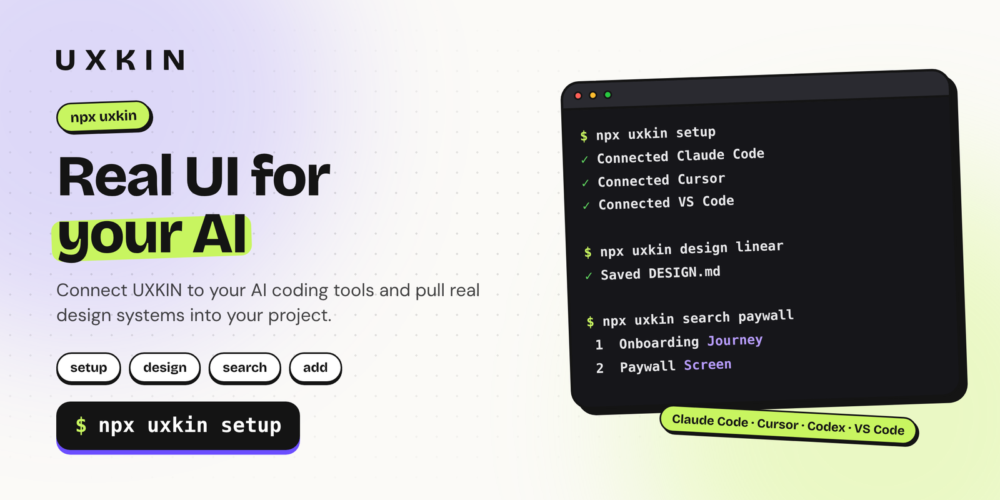

<p align="center">
  <a href="https://uxkin.com/?utm_source=npm&utm_medium=readme&utm_campaign=uxkin"></a>
</p>

<p align="center">
  <a href="https://www.npmjs.com/package/uxkin"></a> <a href="https://www.npmjs.com/package/uxkin"></a>  <a href="https://uxkin.com/?utm_source=npm&utm_medium=readme&utm_campaign=uxkin"></a>
</p>

<h3 align="center">Real UI references for you and your AI, from the terminal.</h3>

<p align="center"><a href="https://uxkin.com/?utm_source=npm&utm_medium=readme&utm_campaign=uxkin">UXKIN</a> is a library of 500,000+ real app screens, user journeys and 15k+ website design systems.<br>This command connects it to your AI coding tools and brings design systems straight into your project.</p>

## Install in one line

```sh
npx uxkin setup
```

No install needed. Node.js 18.17 or newer.

## Connect your AI coding tools

```sh
npx uxkin setup
```

Finds the AI coding tools on your computer and connects UXKIN to them: **Claude Code, Codex, Cursor, VS Code (GitHub Copilot), Windsurf, Antigravity and Kiro**. It shows what it found and asks before changing anything. Only UXKIN is added; your other settings stay as they are, and a copy of each settings file is kept next to it (`.uxkin-backup`) the first time.

Then sign in to UXKIN once inside each tool. Setup tells you where.

Just one tool: `npx uxkin setup cursor`. See what it would do without changing anything: `npx uxkin setup --dry-run`.

## Add a design plugin

```sh
npx uxkin add website-design
```

Adds a UXKIN design plugin's skills to the AI coding tools you choose, then connects UXKIN. The plugins: `website-design`, `mobile-app-design`, `ui-design-review`, `dashboard-design`, `swiftui-app-design` and `paywall-pricing-design` (each also has its own command, such as `npx website-design-skills` or `npx mobile-app-design`). `npx uxkin add` lists them; `--skills-only` adds just the skills.

## Bring a real design system into your project

```sh
npx uxkin design linear
npx uxkin design "dark fintech"
```

Saves the best match's DESIGN.md (colors, type, spacing, components) into the current folder. Then tell your AI: "Follow DESIGN.md." Use `--out docs/DESIGN.md` to save it somewhere else, or `--stdout` to print it.

## Search real screens, journeys and websites

```sh
npx uxkin search "onboarding paywall"
npx uxkin search duolingo
```

## Your collections

```sh
npx uxkin collections
npx uxkin collections "Checkout ideas"
```

Shows what you've saved on uxkin.com.

## For scripts and AI agents

Add `--json` to `search`, `design` and `collections` for machine-readable output. When nobody is at the keyboard, the CLI never changes files on its own: pass `--yes` to `setup` or `--force` to `design` to allow it.

## Signing in

`design`, `search` and `collections` sign you in the first time, in your browser, on uxkin.com's own sign-in page. Your password is never typed into the terminal. New to UXKIN? You can create an account on that page.

```sh
npx uxkin login     # sign in
npx uxkin status    # check
npx uxkin logout    # sign out on this computer
```

The sign-in is kept in `~/.config/uxkin/credentials.json` (on Windows, `%APPDATA%\uxkin`), readable only by you. You can disconnect it any time from your [UXKIN account](https://uxkin.com/account).

Searching needs a UXKIN plan (Monthly or Lifetime): [uxkin.com/choose-plan](https://uxkin.com/choose-plan).

## The design plugins

| Command | What it adds |
|---|---|
| [`npx website-design-skills`](https://www.npmjs.com/package/website-design-skills) | Websites and landing pages from real design systems |
| [`npx mobile-app-design`](https://www.npmjs.com/package/mobile-app-design) | iOS screens and flows from real apps |
| [`npx ui-design-review`](https://www.npmjs.com/package/ui-design-review) | Review and polish any UI against real products |
| [`npx dashboard-design`](https://www.npmjs.com/package/dashboard-design) | Dashboards and data screens |
| [`npx swiftui-app-design`](https://www.npmjs.com/package/swiftui-app-design) | SwiftUI screens and flows |
| [`npx paywall-pricing-design`](https://www.npmjs.com/package/paywall-pricing-design) | App paywalls and pricing pages |

## Source

[github.com/uxkin/agent](https://github.com/uxkin/agent/tree/cli) (branch `cli`). Published from GitHub Actions with npm trusted publishing.

## License

MIT
