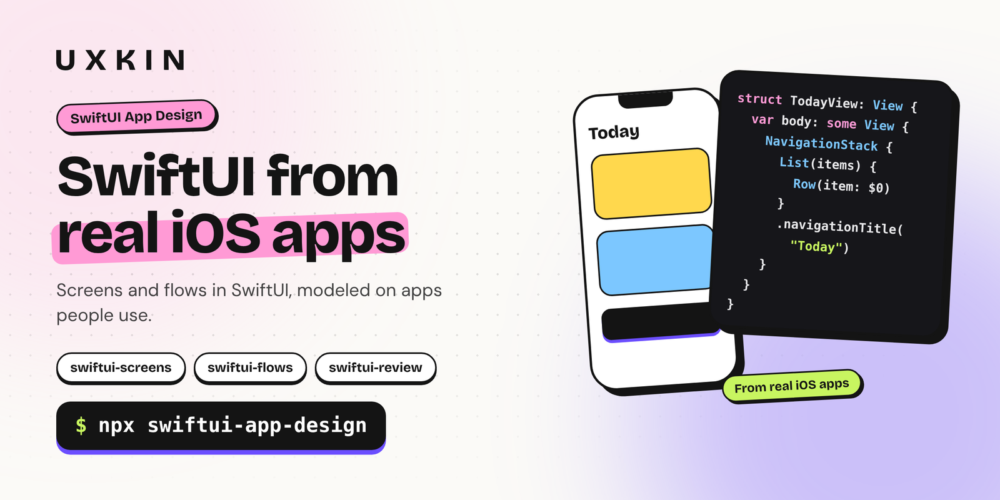

<p align="center">
  <a href="https://uxkin.com/?utm_source=npm&utm_medium=readme&utm_campaign=swiftui-app-design"></a>
</p>

<p align="center">
  <a href="https://www.npmjs.com/package/swiftui-app-design"></a> <a href="https://www.npmjs.com/package/swiftui-app-design"></a>  <a href="https://uxkin.com/?utm_source=npm&utm_medium=readme&utm_campaign=swiftui-app-design"></a>
</p>

<h3 align="center">SwiftUI screens and flows modeled on real iOS apps.</h3>

<p align="center">A design plugin by <a href="https://uxkin.com/?utm_source=npm&utm_medium=readme&utm_campaign=swiftui-app-design">UXKIN</a> for Claude Code, Cursor, Codex and other AI coding tools.<br><b>Real UI, not AI slop.</b></p>

## Install in one line

```sh
npx swiftui-app-design
```

1. **Adds 3 design skills** to the AI coding tools you choose.
2. **Connects UXKIN**, so those skills can look at 500,000+ real iOS app screens and user journeys before they design.
3. **Sign in once** in each tool, then just ask your AI.

## What you get

| Skill | What it does | Try asking |
|---|---|---|
| **`swiftui-screens`** | Builds SwiftUI screens from real apps | *"Build the profile screen in SwiftUI"* |
| **`swiftui-flows`** | Builds whole flows (onboarding, paywall, settings) in SwiftUI | *"Build onboarding in SwiftUI"* |
| **`swiftui-review`** | Reviews SwiftUI screens against real products | *"Review my SwiftUI views"* |

## Works with

Claude Code · Cursor · Codex · GitHub Copilot (VS Code) · Windsurf · Antigravity · Kiro · Cline · and 15+ more tools that read agent skills.

## Real UI behind it

Your AI designs from [500,000+ real iOS app screens and user journeys](https://uxkin.com/mobile?utm_source=npm&utm_medium=readme&utm_campaign=swiftui-app-design) on [UXKIN](https://uxkin.com/?utm_source=npm&utm_medium=readme&utm_campaign=swiftui-app-design) instead of guessing. The skills also work on their own; the real references need a [UXKIN plan](https://uxkin.com/choose-plan?utm_source=npm&utm_medium=readme&utm_campaign=swiftui-app-design).

## Options

```sh
npx swiftui-app-design --skills-only   # just the skills, no UXKIN connection
npx swiftui-app-design --yes           # don't ask: all your AI tools, for your user
npx swiftui-app-design --help
```

<details>
<summary><b>What changes on my computer?</b></summary>

The skills are copied into your AI tools' skills folder (for most tools, `~/.agents/skills`). In each tool's settings, only a `uxkin` entry is added; your other settings stay as they are, and a copy of each settings file is kept next to it (`.uxkin-backup`) the first time. Sign-in happens on uxkin.com in your browser; your password never goes through the terminal.

</details>

## More from UXKIN

| Command | What it is |
|---|---|
| [`npx uxkin`](https://www.npmjs.com/package/uxkin) | UXKIN CLI: setup, design, search |
| [`npx website-design-skills`](https://www.npmjs.com/package/website-design-skills) | Website Design |
| [`npx mobile-app-design`](https://www.npmjs.com/package/mobile-app-design) | Mobile App Design |
| [`npx ui-design-review`](https://www.npmjs.com/package/ui-design-review) | UI Design Review |
| [`npx dashboard-design`](https://www.npmjs.com/package/dashboard-design) | Dashboard Design |
| [`npx paywall-pricing-design`](https://www.npmjs.com/package/paywall-pricing-design) | Paywall & Pricing Design |

Requires Node.js 18.17 or newer. Same as `npx uxkin add swiftui-app-design`.

## Source

[github.com/uxkin/agent](https://github.com/uxkin/agent/tree/cli) (branch `cli`). Published from GitHub Actions with npm trusted publishing.

## License

MIT
