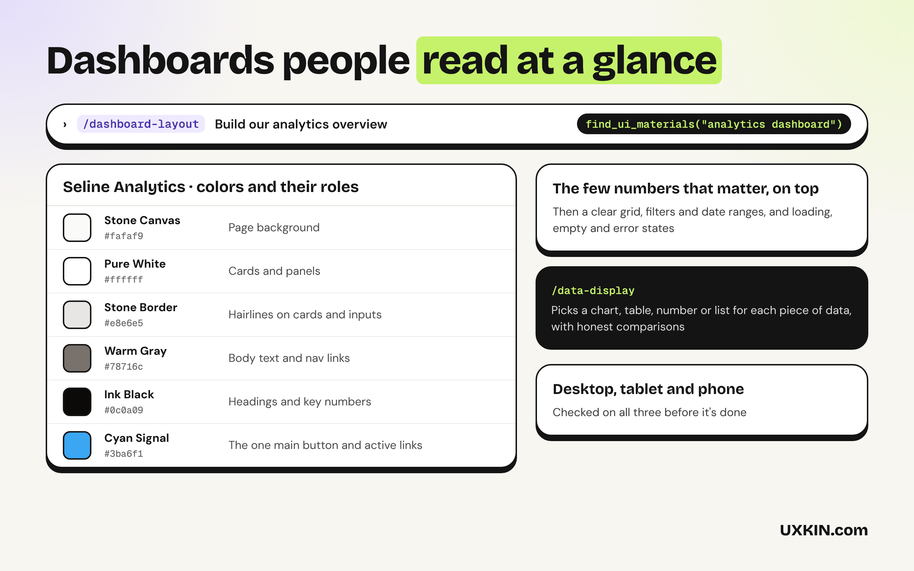
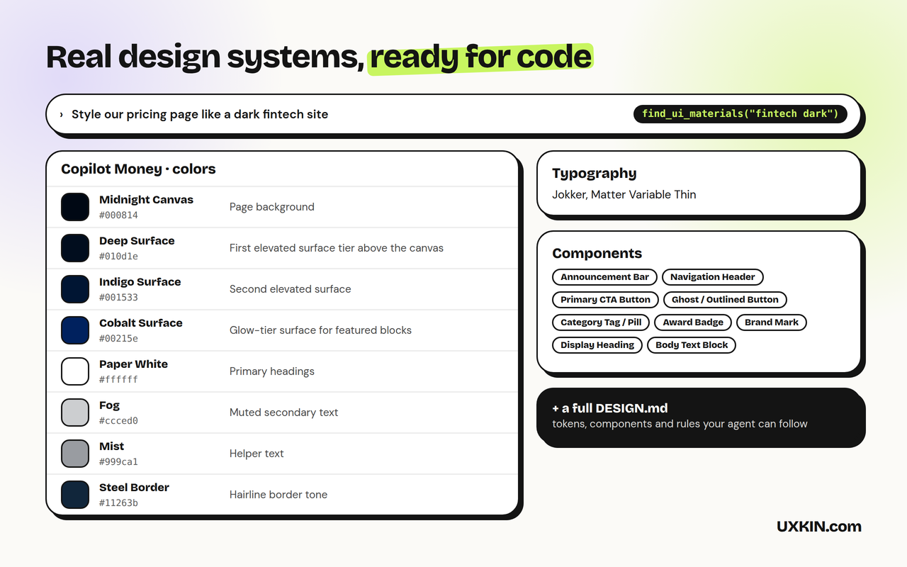

# Dashboard Design

Dashboards built by AI usually show everything at once. These skills help Copilot pick the few numbers that matter, lay out navigation, choose charts and tables that fit the data, and design every state. By [UXKIN](https://uxkin.com).

## What's inside

| | What it does |
|---|---|
| **dashboard-layout** skill | Plans the layout and navigation, with the few numbers that matter on top |
| **data-display** skill | Chooses charts and tables that fit the data, with filters and loading, empty and error states |
| **dashboard-review** skill | Reviews an existing dashboard and lists what to fix, most important first |
| UXKIN MCP server (optional) | Real app screens and design systems from real SaaS websites |

The skills work on their own, with no account. The UXKIN server is optional: Copilot can use it to look up real references, and searching the library needs a UXKIN plan.

## How to use it

1. Open **Copilot Chat** and switch to **Agent** mode.
2. Ask for what you want, for example "build a pricing page" or "review this screen". Copilot picks the right skill on its own, or type `/dashboard-layout`, `/data-display`, `/dashboard-review` to use one by name.
3. The first time Copilot uses UXKIN, VS Code asks you to sign in. Log in with your UXKIN account and click **Allow**. No API key to copy.

Check the connection under **MCP Servers** in the Extensions view: **UXKIN (Dashboard Design)** should be running.

Requires VS Code 1.109 or later with GitHub Copilot for the skills.

## What it sends

The skills run inside Copilot and send nothing anywhere. When the UXKIN server is used, Copilot sends its search words to `https://uxkin.com/mcp` and receives references; the tools only read. See the [privacy policy](https://uxkin.com/privacy).

## Support

Email support@uxkin.com or open an issue on [GitHub](https://github.com/uxkin/agent/issues).

## License

MIT. The UXKIN library itself is a hosted service, not part of this extension: see the [terms](https://uxkin.com/terms).
