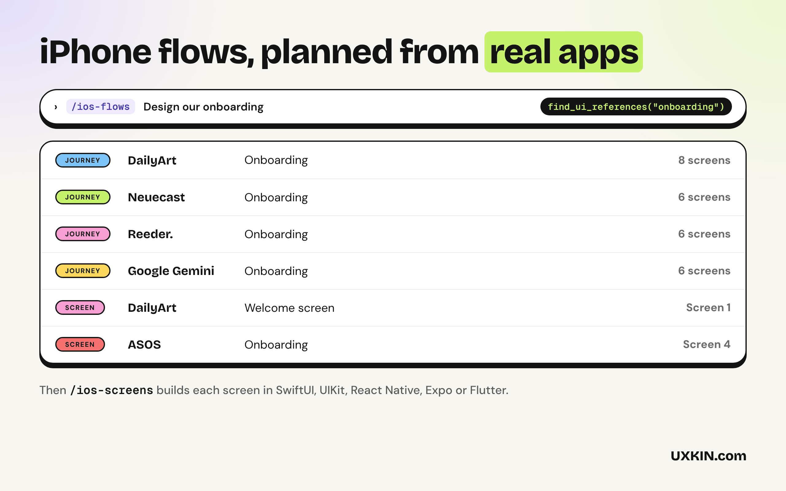
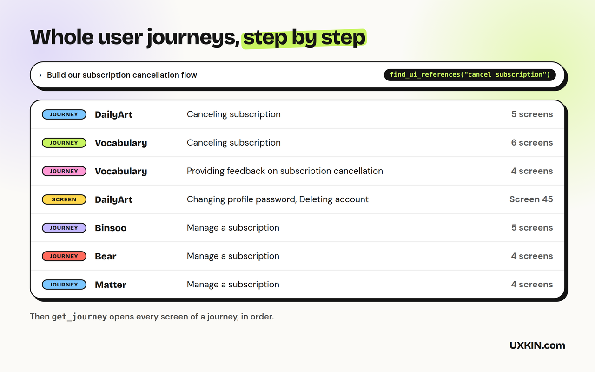

# Mobile App Design

These skills help Copilot build iPhone screens and flows that feel native, in SwiftUI, UIKit, React Native, Expo or Flutter, planned from how real iOS apps handle the same flow. By [UXKIN](https://uxkin.com).

## What's inside

| | What it does |
|---|---|
| **ios-screens** skill | Builds native-feeling iPhone screens: navigation, sheets, Dynamic Type, dark mode, permissions, paywalls, checked on small and large iPhones |
| **ios-flows** skill | Plans a multi-step flow (onboarding, sign-up, paywall, permissions, cancellation, account deletion, settings) from how real apps handle it |
| **ios-review** skill | Reviews an existing screen or flow and lists what to fix, most important first |
| UXKIN MCP server (optional) | 300+ real iOS apps with their screens and complete user journeys |

The skills work on their own, with no account. The UXKIN server is optional: Copilot can use it to look up real references, and searching the library needs a UXKIN plan.

## How to use it

1. Open **Copilot Chat** and switch to **Agent** mode.
2. Ask for what you want, for example "build a pricing page" or "review this screen". Copilot picks the right skill on its own, or type `/ios-screens`, `/ios-flows`, `/ios-review` to use one by name.
3. The first time Copilot uses UXKIN, VS Code asks you to sign in. Log in with your UXKIN account and click **Allow**. No API key to copy.

Check the connection under **MCP Servers** in the Extensions view: **UXKIN (Mobile App Design)** should be running.

Requires VS Code 1.109 or later with GitHub Copilot for the skills.

## What it sends

The skills run inside Copilot and send nothing anywhere. When the UXKIN server is used, Copilot sends its search words to `https://uxkin.com/mcp/mobile` and receives references; the tools only read. See the [privacy policy](https://uxkin.com/privacy).

## Support

Email support@uxkin.com or open an issue on [GitHub](https://github.com/uxkin/agent/issues).

## License

MIT. The UXKIN library itself is a hosted service, not part of this extension: see the [terms](https://uxkin.com/terms).
