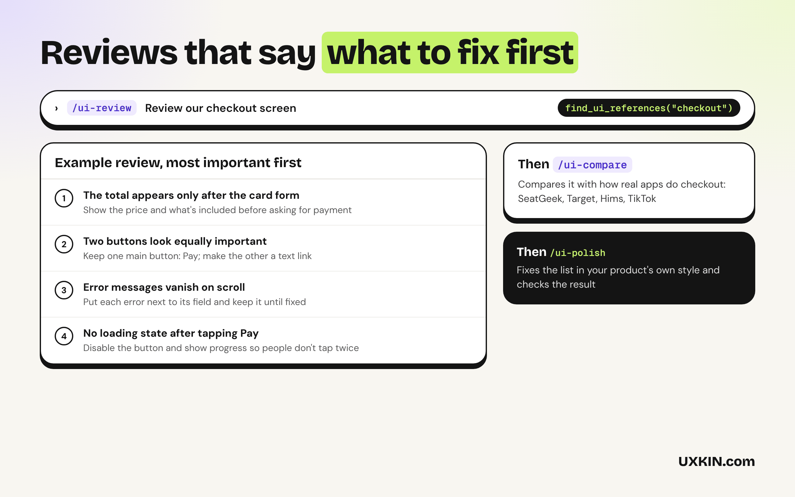
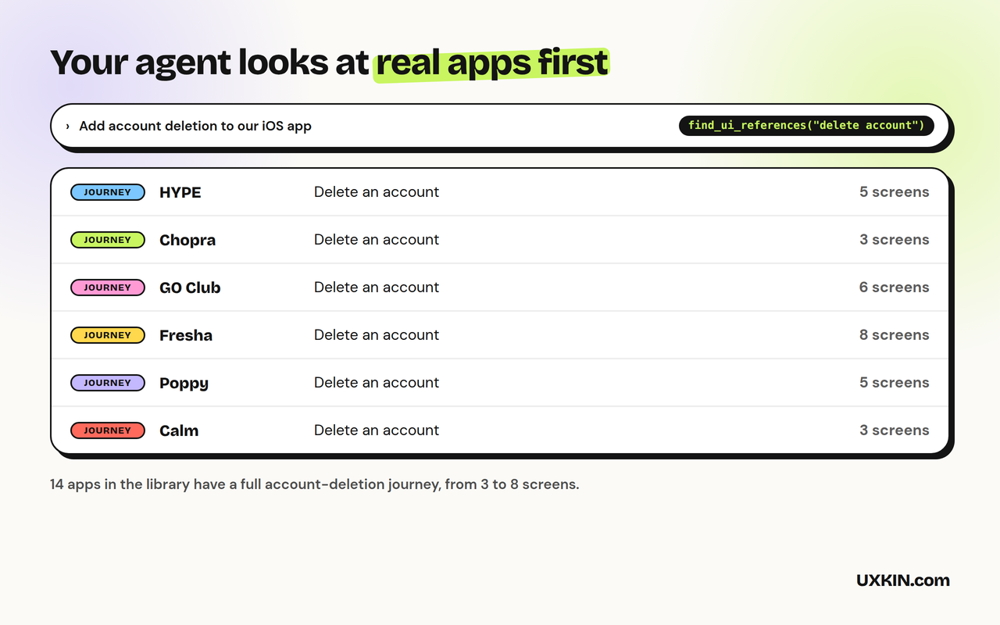

# UI Design Review

Ask Copilot to review a screen and it often just restates the code. These skills make it look at the rendered result, rank what's wrong, fix what you pick in your app's own style, and compare with how real products solve the same thing. By [UXKIN](https://uxkin.com).

## What's inside

| | What it does |
|---|---|
| **ui-review** skill | Looks at the rendered screen on phone and desktop and lists what to fix, most important first |
| **ui-polish** skill | Fixes the issues you pick, in the app's own components and style |
| **ui-compare** skill | Compares a screen with how real products handle the same thing |
| UXKIN MCP server (optional) | Real iOS app screens and user journeys, and design systems from real websites |

The skills work on their own, with no account. The UXKIN server is optional: Copilot can use it to look up real references, and searching the library needs a UXKIN plan.

## How to use it

1. Open **Copilot Chat** and switch to **Agent** mode.
2. Ask for what you want, for example "build a pricing page" or "review this screen". Copilot picks the right skill on its own, or type `/ui-review`, `/ui-polish`, `/ui-compare` to use one by name.
3. The first time Copilot uses UXKIN, VS Code asks you to sign in. Log in with your UXKIN account and click **Allow**. No API key to copy.

Check the connection under **MCP Servers** in the Extensions view: **UXKIN (UI Design Review)** should be running.

Requires VS Code 1.109 or later with GitHub Copilot for the skills.

## What it sends

The skills run inside Copilot and send nothing anywhere. When the UXKIN server is used, Copilot sends its search words to `https://uxkin.com/mcp` and receives references; the tools only read. See the [privacy policy](https://uxkin.com/privacy).

## Support

Email support@uxkin.com or open an issue on [GitHub](https://github.com/uxkin/agent/issues).

## License

MIT. The UXKIN library itself is a hosted service, not part of this extension: see the [terms](https://uxkin.com/terms).
