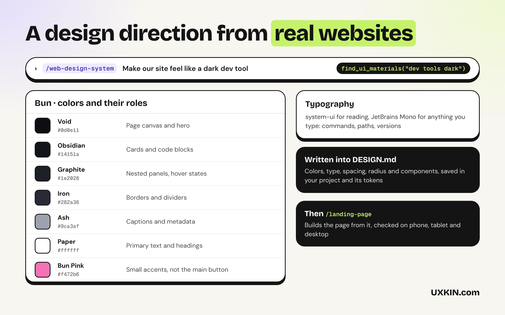
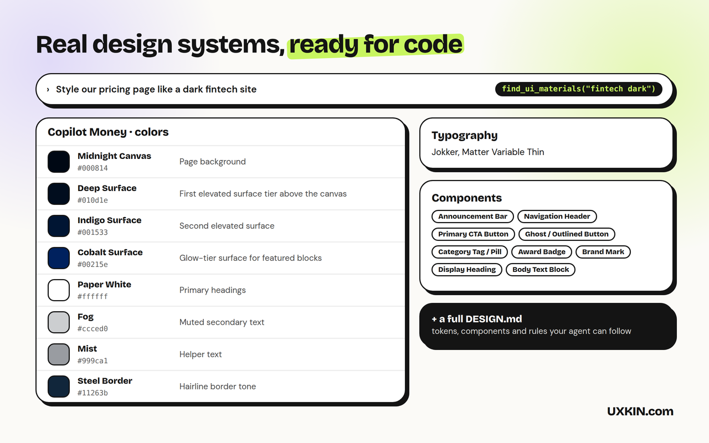

# Website Design

Websites built by AI tend to look alike. These skills give Copilot a design direction taken from real websites, write it down as a DESIGN.md, build pages that work on phone and desktop, and review what you already have. By [UXKIN](https://uxkin.com).

## What's inside

| | What it does |
|---|---|
| **web-design-system** skill | Chooses colors with their roles, typography, spacing and components from how real websites in the same space look, and writes them into a DESIGN.md and the project's tokens |
| **landing-page** skill | Builds landing, home, pricing and feature pages with specific copy and no invented proof, following the DESIGN.md, checked on phone, tablet and desktop |
| **web-review** skill | Reviews an existing site or page and lists what to fix, most important first |
| UXKIN MCP server (optional) | 15k+ design systems taken from real websites, each with a DESIGN.md |

The skills work on their own, with no account. The UXKIN server is optional: Copilot can use it to look up real references, and searching the library needs a UXKIN plan.

## How to use it

1. Open **Copilot Chat** and switch to **Agent** mode.
2. Ask for what you want, for example "build a pricing page" or "review this screen". Copilot picks the right skill on its own, or type `/web-design-system`, `/landing-page`, `/web-review` to use one by name.
3. The first time Copilot uses UXKIN, VS Code asks you to sign in. Log in with your UXKIN account and click **Allow**. No API key to copy.

Check the connection under **MCP Servers** in the Extensions view: **UXKIN (Website Design)** should be running.

Requires VS Code 1.109 or later with GitHub Copilot for the skills.

## What it sends

The skills run inside Copilot and send nothing anywhere. When the UXKIN server is used, Copilot sends its search words to `https://uxkin.com/mcp` and receives references; the tools only read. See the [privacy policy](https://uxkin.com/privacy).

## Support

Email support@uxkin.com or open an issue on [GitHub](https://github.com/uxkin/agent/issues).

## License

MIT. The UXKIN library itself is a hosted service, not part of this extension: see the [terms](https://uxkin.com/terms).
